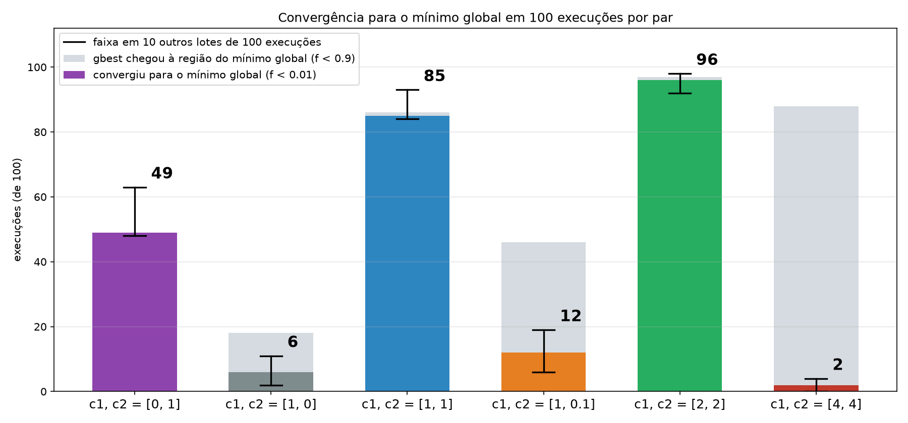
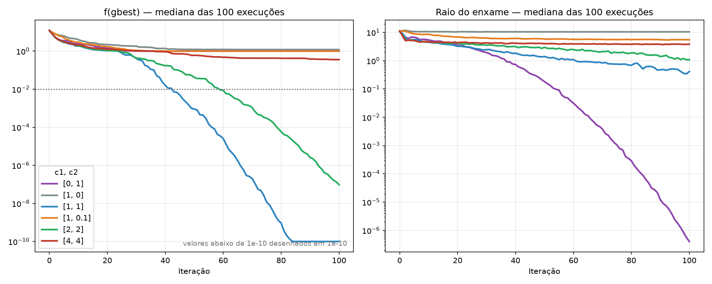
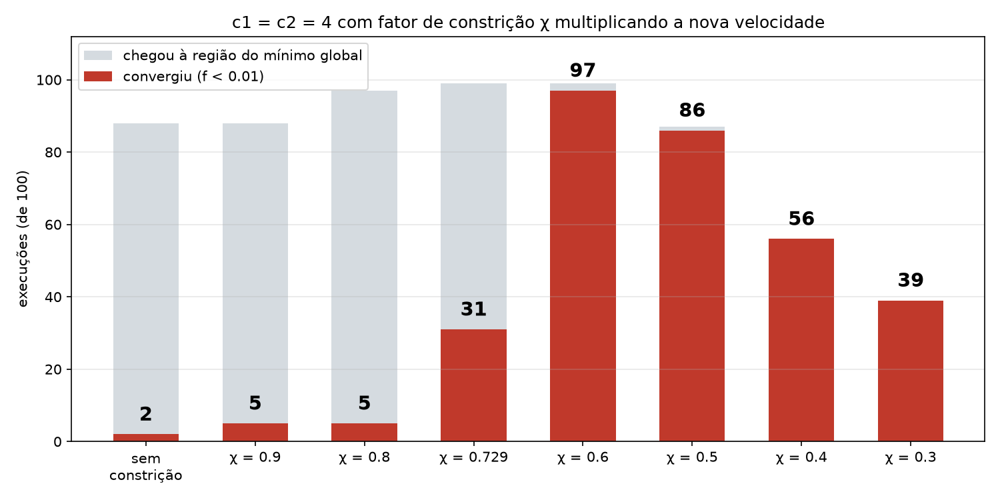

# Otimização por Enxame de Partículas (PSO) na função de Rastrigin

Trabalho prático: implementar o PSO para encontrar o mínimo global da função de Rastrigin com
n = 2 (f = 0 em x = 0, y = 0), com 15 partículas e 100 iterações como critério de parada.

```
f(x, y) = 20 + x² − 10·cos(2πx) + y² − 10·cos(2πy),   x, y ∈ [−5,12; 5,12]
```

- **Parte 1:** vídeo das partículas se movendo sobre o gráfico de contorno.
- **Parte 2:** efeito de c1 e c2 na convergência, com os pares [0, 1], [1, 0], [1, 1], [1, 0.1],
  [2, 2] e [4, 4], 100 execuções por par, e um vídeo por par.

## Como rodar

```
pip install numpy matplotlib imageio-ffmpeg scipy
python parte1.py
python parte2.py
```

`parte2.py` gera os 8 vídeos e leva alguns minutos. Para refazer só os números e os
gráficos, sem os vídeos: `python parte2.py --sem-videos`.

Os slides ficam em `slides/` (precisam do Node e do `python-pptx`):

```
cd slides
python figuras.py
python capas_video.py
node gerar_slides.js
python corrige_videos.py
```

O `corrige_videos.py` é necessário: o pptxgenjs dá o mesmo número de identificação a duas formas
do slide (um vídeo e uma caixa de texto) e não grava o bloco de timing que liga o clique ao play.
Com dois vídeos no mesmo slide, o da direita não tocava. O script renumera as formas e grava o
timing no mesmo formato que o próprio PowerPoint usa.

Os slides leem os números de `saida/resumo_parte1.json`, `saida/resumo_parte2.json` e
`slides/img/extras.json`. Nenhum valor é digitado à mão.

## Arquivos

| arquivo | o que é |
|---|---|
| `pso.py` | o algoritmo (classe `EnxameParticulas`) e a função de Rastrigin |
| `parte1.py` | execução da Parte 1, gráficos e a função `gera_video`, reaproveitada na Parte 2 |
| `parte2.py` | as 100 execuções por par, as verificações de robustez, o extra da constrição e os vídeos |
| `saida/parte1_enxame.mp4` | vídeo da Parte 1 |
| `saida/parte2_c1-*_c2-*.mp4` | um vídeo por par de c1, c2 (o enunciado pede) |
| `saida/parte2_comparativo.mp4` | os seis pares lado a lado, partindo do mesmo enxame |
| `saida/parte2_constricao.mp4` | [4, 4] sem constrição, com χ ideal e com χ demais, lado a lado |
| `saida/parte1_saida.txt`, `saida/parte2_saida.txt` | a saída de texto dos dois scripts |
| `slides/apresentacao.pdf` | apresentação em PDF (o pptx com os vídeos embutidos é grande demais para o repositório) |

## A implementação e de onde veio cada escolha

O enunciado fixa a função, o domínio, n = 2, 15 partículas, 100 iterações e os pares de c1, c2.
O resto veio do material de aula ou foi escolha nossa:

| item | valor | origem |
|---|---|---|
| atualização da velocidade | v ← w·v + c1·r1·(pbest − x) + c2·r2·(gbest − x) | material de aula |
| inércia | cai em linha reta de 0,9 para 0,4: W(k+1) = 0,9 − k·(0,9 − 0,4)/100 | material de aula (Shi e Eberhart, 1998) |
| c1, c2 na Parte 1 | 2 e 2 | material de aula (mesmo slide da inércia) |
| saiu do domínio | a coordenada volta para a borda e a velocidade nela é zerada | material de aula |
| velocidade máxima | 2,048, ou 20% da largura do domínio | nossa (a aula cita Vmax sem dar valor) |
| velocidade inicial | sorteada entre −Vmax e +Vmax | nossa |
| r1, r2 | sorteados entre 0 e 1 para cada partícula e cada coordenada | nossa |
| ordem dos passos | mover todas, avaliar todas, atualizar pbest e gbest | material de aula (algoritmo da página 19) |
| convergiu | f(gbest) < 0,01 ao fim das 100 iterações | nossa |

**Por que f < 0,01.** O enunciado pede para contar as vezes em que "houve a convergência para o
mínimo global", mas não diz como medir. A função tem 121 mínimos locais no domínio, e o melhor
deles, em (±1, 0), vale 0,995. Então abaixo de 0,01 o gbest está com certeza no vale do mínimo
global e já refinou a posição (fica a menos de ~0,007 da origem). Também contamos f < 0,9, que
quer dizer só que o gbest chegou ao vale certo; a diferença entre as duas contagens é o que
explica o par [4, 4].

## Parte 1

c1 = c2 = 2, semente 2.

```
melhor posicao encontrada: (0.000006, -0.000018)
valor da funcao nessa posicao: 6.770e-08
CONVERGIU para o minimo global (f < 0.01) na iteracao 58
raio do enxame: 10.615 no inicio, 0.483 no fim
```

O vídeo tem 16 segundos. O painel da esquerda é o contorno com as partículas, um rastro curto e o
gbest (estrela vermelha). O da direita é um zoom que acompanha o gbest e vai fechando conforme o
enxame se junta, até uma janela de 0,04 × 0,04. Embaixo, f(gbest) e o raio do enxame (a maior
distância entre duas partículas), ambos em escala log.

A execução passa por três fases: exploração até a iteração 10 (f cai de 17,0 para 1,49), o
enxame se juntando no vale central até a 30 (raio de 4,9 para 3,1) e o refinamento até a 100,
com a inércia perto de 0,4.

## Parte 2

Sementes 0 a 99 para todos os pares, ou seja, os seis pares partem dos mesmos 100 enxames iniciais.

| c1, c2 | convergiu (f < 0,01) | chegou ao vale (f < 0,9) | em 10 outros lotes de 100 |
|---|---|---|---|
| [0, 1] | 49 | 49 | 48 a 63 |
| [1, 0] | 6 | 18 | 2 a 11 |
| [1, 1] | 85 | 86 | 84 a 93 |
| [1, 0.1] | 12 | 46 | 6 a 19 |
| [2, 2] | **96** | 97 | 92 a 98 |
| [4, 4] | 2 | 88 | 0 a 4 |



**O que explica cada resultado** (os vídeos mostram, e o raio do enxame confirma):



- **[0, 1], só social.** Ninguém lembra do próprio melhor ponto; todas as partículas correm para
  o gbest e o enxame vira um ponto (raio final mediano 4 × 10⁻⁷). É convergência prematura: o
  enxame converge para onde o gbest estiver. Quando ele está no vale certo, o refinamento é
  perfeito (as 49 que chegam ao vale também passam de 0,01); quando não está, ninguém sai.
- **[1, 0], só cognitivo.** Sem troca de informação, são 15 buscas locais independentes. O
  enxame nunca se junta (raio final mediano 10,5). Só converge quando alguma partícula já nasce
  perto da origem.
- **[1, 0.1], social fraco.** Parecido com o [1, 0]: o gbest puxa pouco demais para juntar o
  enxame em 100 iterações. Chega ao vale em 46, mas refina em 12.
- **[1, 1], equilibrado.** O enxame se junta no vale do gbest sem colapsar num ponto (raio final
  mediano 0,41) e continua refinando.
- **[2, 2], o valor do material de aula.** O melhor par. Passos maiores que no [1, 1]: quando
  acerta, refina um pouco mais devagar, mas explora mais antes de se fechar e erra menos.
- **[4, 4], intenso demais.** Chega ao vale do mínimo em 88 execuções, mas converge em 2. Os
  passos são tão grandes que as partículas saltam por cima do mínimo e o enxame não assenta
  (raio final mediano 3,8). É o que o material de aula descreve: com c1 e c2 altos o enxame
  explora de forma global, sem se concentrar em buscas locais.

**Os vídeos** usam a semente 2 nos seis pares, com o mesmo enxame inicial. Escolhemos essa
semente porque nela cada par mostra o seu desfecho mais comum na tabela (o [1, 1] e o [2, 2]
convergem; o [1, 0] e o [1, 0.1] não; o [4, 4] chega ao vale sem convergir). A exceção é o
[0, 1], que converge em cerca de metade das execuções; na semente 2 ele mostra o modo de falha,
colapsando em (−0,995, 0), o mínimo local vizinho da origem.

### O resultado depende das nossas escolhas?

**Da tolerância:**

| c1, c2 | f < 0,9 | f < 0,01 | f < 10⁻⁴ | f < 10⁻⁶ |
|---|---|---|---|---|
| [0, 1] | 49 | 49 | 49 | 49 |
| [1, 0] | 18 | 6 | 1 | 0 |
| [1, 1] | 86 | 85 | 84 | 83 |
| [1, 0.1] | 46 | 12 | 5 | 1 |
| [2, 2] | 97 | 96 | 95 | 76 |
| [4, 4] | 88 | 2 | 0 | 0 |

Entre 0,01 e 10⁻⁴ os três pares de cima quase não mudam; os que já convergiam pouco caem mais um
pouco. Só com tolerâncias muito apertadas o [2, 2] perde para o [1, 1], pelo motivo acima:
refina mais devagar.

**Da velocidade máxima** (fração da largura do domínio; usamos 0,2):

| c1, c2 | 0,1 | 0,2 | 0,3 | 1,0 | sem limite |
|---|---|---|---|---|---|
| [0, 1] | 50 | 49 | 63 | 56 | 56 |
| [1, 0] | 5 | 6 | 6 | 6 | 6 |
| [1, 1] | 76 | 85 | 90 | 87 | 86 |
| [1, 0.1] | 17 | 12 | 10 | 20 | 20 |
| [2, 2] | 86 | 96 | 96 | 88 | 87 |
| [4, 4] | 2 | 2 | 2 | 0 | 0 |

Os números mudam, mas os grupos não: [1, 1] e [2, 2] sempre no topo, [0, 1] no meio, os outros
três sempre bem abaixo.

Um cuidado que encontramos: **não usar Vmax = 5,12**, exatamente metade da largura. Com esse
valor, uma partícula presa na borda (x = ±5,12) que dá um passo de velocidade máxima cai
exatamente em x = 0. Com isso o [4, 4] passa a "convergir" em 61 de 100 execuções, 57 delas com
f exatamente igual a zero. Com Vmax = 0,49 da largura, volta a 0. É artefato numérico, não busca.

**Da amostra:** a última coluna da tabela principal repete as 100 execuções em 10 lotes com
sementes diferentes (10000 a 10999). As faixas mostram a variação esperada de um lote para outro.

### Extra: dá para salvar o [4, 4]?

Fora do pedido do enunciado. O material de aula pergunta se há como amortecer a velocidade das
partículas com c1 e c2 altos e apresenta o fator de constrição. Testamos no [4, 4], com o χ
multiplicando a nova velocidade inteira (v ← χ·(w·v + c1·r1·(pbest − x) + c2·r2·(gbest − x))),
nas mesmas 100 sementes:

| χ | 1 (sem) | 0,9 | 0,8 | 0,729 | 0,6 | 0,5 | 0,4 | 0,3 |
|---|---|---|---|---|---|---|---|---|
| convergiu | 2 | 5 | 5 | 31 | **97** | 86 | 56 | 39 |
| chegou ao vale | 88 | 88 | 97 | 99 | 99 | 87 | 56 | 39 |

Com χ = 0,6 o [4, 4] vai de 2 para 97: as partículas continuam explorando no começo e agora
assentam no fim. Depois do ideal, amortecer mais volta a atrapalhar, e a queda continua nos dois
valores que testamos além do 0,5 (86 → 56 → 39). O motivo é o mesmo do par [0, 1]: com a
velocidade amortecida demais o enxame colapsa num ponto cedo demais (raio final mediano da ordem
de 10⁻⁹ com χ = 0,4 e 0,3) e, se esse ponto não está no vale do mínimo global, ninguém sai dali.

O vídeo `saida/parte2_constricao.mp4` mostra os três casos lado a lado, partindo do mesmo enxame:
sem constrição, χ = 0,6 e χ = 0,3. Usa a semente 0, a primeira em que os três mostram o desfecho
mais comum de cada um (sem constrição não converge, χ = 0,6 converge, χ = 0,3 colapsa no vale
vizinho, com f = 0,996).


