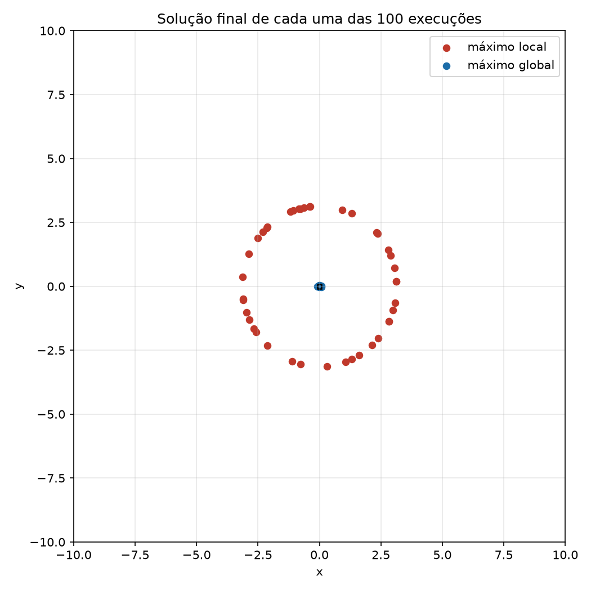
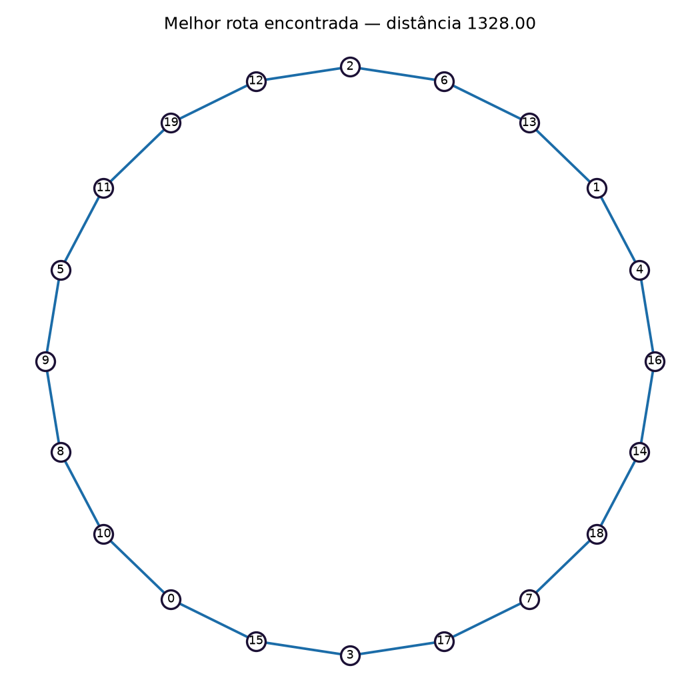
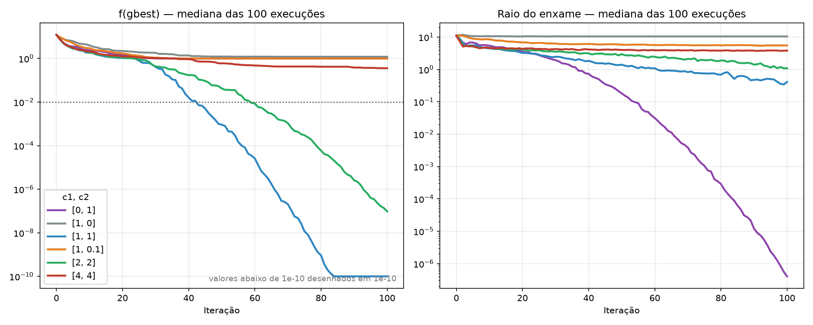
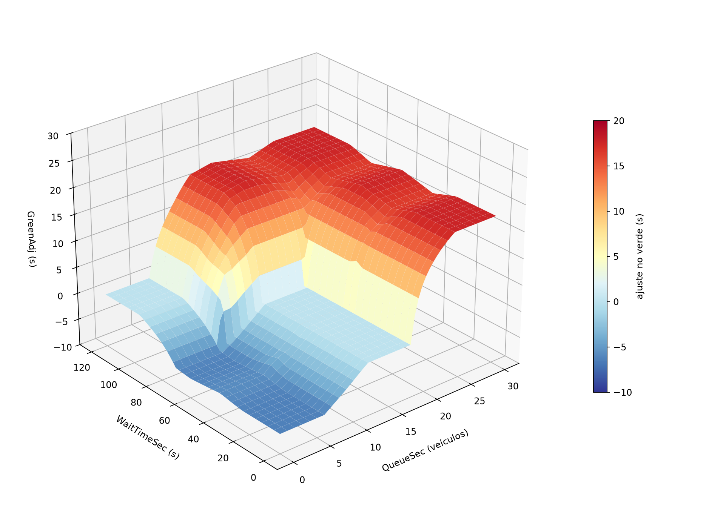
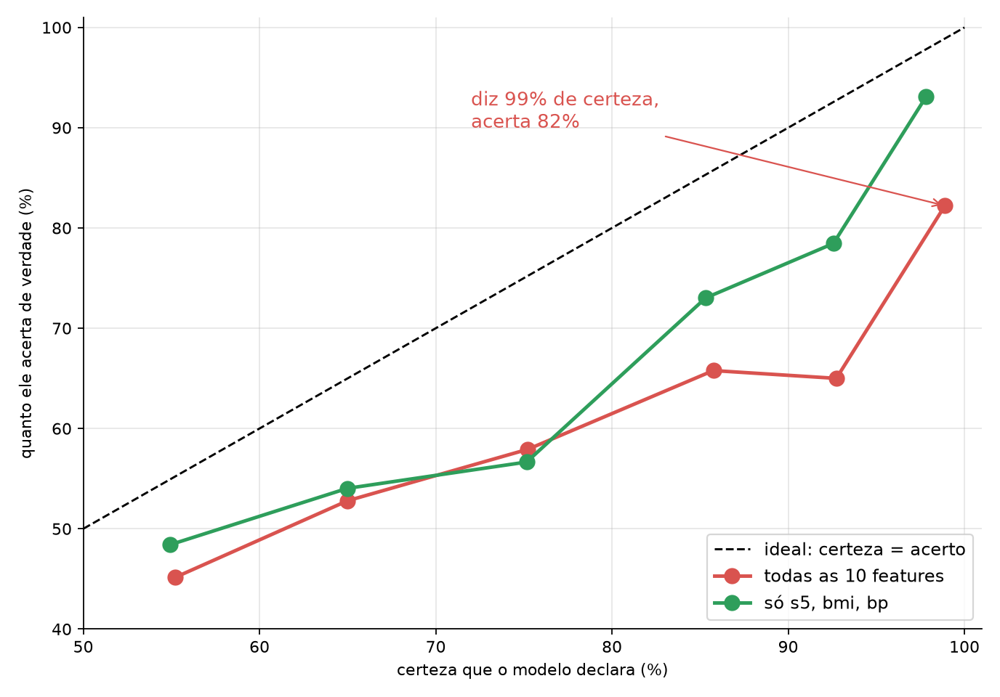
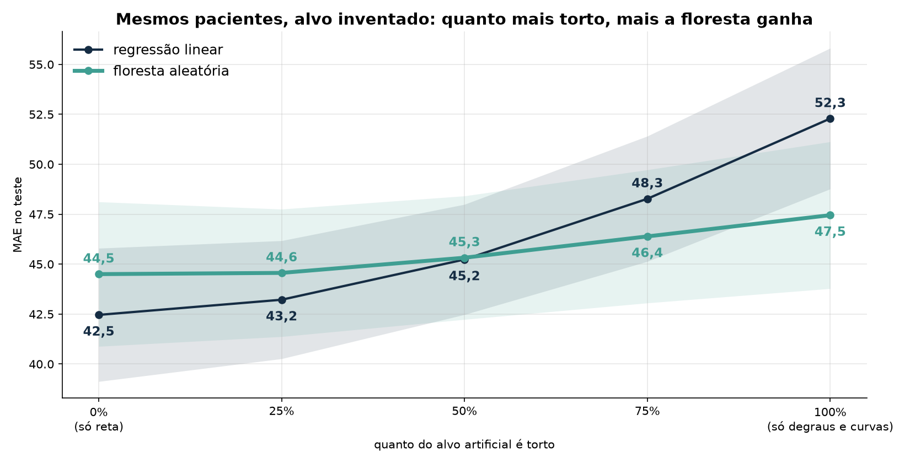

# AI from scratch: six classic algorithms, implemented and stress-tested

Coursework for the Artificial Intelligence course at CEFET-MG (Computer Engineering, 2026.2).
Each project implements one classic algorithm by hand in Python (numpy only for the core),
runs the experiments the assignment asked for, and then goes one step further with an extra
experiment that tries to break or explain the result.

The write-ups inside each folder, the slides and the plot labels are in Portuguese.
This page is the English index.

| # | Project | Problem | Headline result |
|---|---|---|---|
| 01 | [Genetic algorithm](01-genetic-algorithm) | Maximise Schaffer's F6, a deceptive function | Roulette + elitism reaches the global maximum in only 48% of runs; fitness sharing lifts it to 59% |
| 02 | [Ant colony optimisation](02-ant-colony) | 20-city travelling salesman | Tour length 1505 → 1328; more ants mostly buy consistency, not a better tour |
| 03 | [Particle swarm optimisation](03-particle-swarm) | Minimise 2D Rastrigin | c1 = c2 = 2 converges in 96 of 100 runs, c1 = c2 = 4 in 2; a constriction factor of 0.6 brings that back to 97 |
| 04 | [Fuzzy logic](04-fuzzy-logic) | Traffic-light green-time controller | Beats a fixed 30 s light in every scenario, but loses to the best fixed timing in light traffic |
| 05 | [Naive Bayes](05-naive-bayes) | Diabetes dataset, above or below mean progression | 73.1% accuracy; the model says "99% sure" and is right 82% of the time |
| 06 | [Regression trees and random forests](06-trees-and-forests) | Diabetes dataset, predict progression | Tree MAE 64.1 → forest 46.9, and plain linear regression still wins with 44.7 |

## What is in each project

### 01 · Genetic algorithm

Schaffer's F6 has one global maximum surrounded by rings of local maxima almost as high.
Over 100 runs with identical parameters, tournament selection found the global maximum 28%
of the time, roulette 48%, roulette with fitness sharing 59% and deterministic crowding 80%.
The failed runs all end on the first ring.



### 02 · Ant colony optimisation

ACO on a 20-city distance matrix, with a video of the pheromone trails forming. The sweeps
over colony size and evaporation rate show that the standard deviation between runs falls
much faster than the mean tour length.



### 03 · Particle swarm optimisation

Six (c1, c2) pairs, 100 seeded runs each, one video per pair. The interesting failure is
c1 = c2 = 4: the swarm reaches the right valley in 88 runs but never settles, so only 2
count as converged. Adding a constriction factor fixes it, and too much constriction breaks
it again.



### 04 · Fuzzy logic

A Mamdani controller written from scratch (checked against scikit-fuzzy, largest difference
0.015 s) that adjusts the green time from queue length and waiting time. The extra is an
intersection simulator, 100 seeds per scenario, comparing the controller with fixed timings.
The honest result: it is better than the default fixed light everywhere, but in light
traffic a well-chosen fixed timing still beats it.



### 05 · Naive Bayes

Gaussian Naive Bayes by hand, matching scikit-learn's `GaussianNB`. Three features do as
well as all ten (73.1%), and accuracy peaks at five (75.0% over 300 splits). The extra
looks at calibration: correlated features make the model overconfident.



### 06 · Regression trees and random forests

A variance-reduction regression tree and a random forest by hand. An unpruned tree memorises
the training set (MAE 0) and scores 64.1 on the test set, barely better than always
predicting the mean (67.3). The forest gets 46.9, and linear regression gets 44.7.

That last number bothered us, so the extra keeps the same patients and swaps the target for
a synthetic one that goes from a pure line to steps and interactions. On the line, linear
regression wins in 10 of 10 splits. On the bent target, the forest wins in 9 of 10.
The forest did not lose because it is a worse model; it lost because this dataset is close
to a straight line.



The folder also has an in-browser demo of the trained forest
(`06-trees-and-forests/demo/floresta_ao_vivo.html`) and a closing experiment that tunes the
tree with the genetic algorithm and the particle swarm from projects 01 and 03.

## Running

Each folder is self-contained and has its own README with the exact commands.
The common requirements are:

```
pip install numpy matplotlib imageio-ffmpeg scikit-learn
```

scikit-learn is used only to load the Diabetes dataset and to cross-check the hand-written
implementations. Seeds are fixed, so the numbers above reproduce.

Every number on the slides is read from the JSON files the experiment scripts write in
`saida/`. Nothing is typed by hand into the slide generator.

## Notes

- The slide deck of project 03 is included as PDF only; the original file embeds nine
  videos and is too large for the repository. The videos are in `03-particle-swarm/saida/`.
- `02-ant-colony/distancia_matrix.csv` is the distance matrix handed out with the assignment.

## Authors

David Lanza Melo Matos, Lucca Molinari Barbosa and Nicolas Rodrigues de Vargas.
